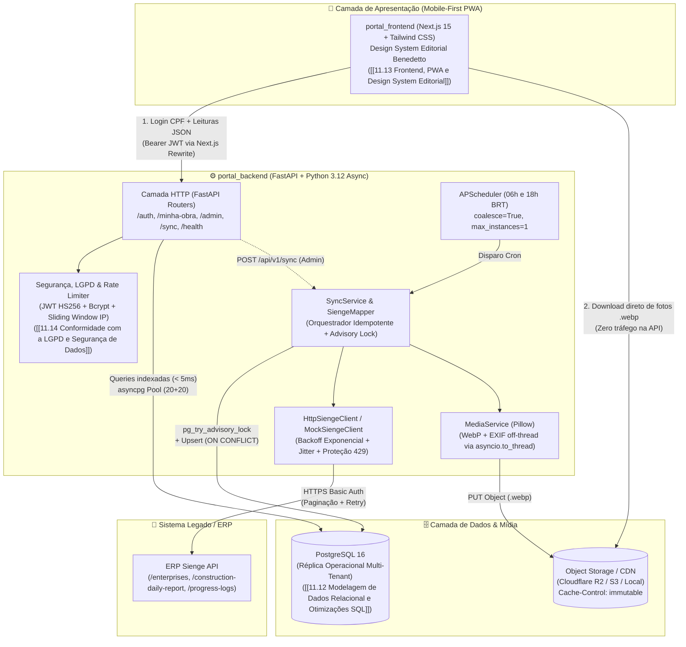

# 11.01 App — Portal do Condômino (Arquitetura & MOC)

> Documentação técnica central e Mapa de Conteúdo (MOC) do **BFF (Backend for Frontend) do Portal & App do Condômino** da Construtora Benedetto.

---

## 1. Visão Geral da Arquitetura & Padrão BFF

### 1.1 Propósito do Sistema
O **Portal & App do Condômino** permite que investidores e proprietários que financiam a construção de empreendimentos da Construtora Benedetto (como *RIVUS*, *VIRTUS*, *Jardim Casalta*, *Loft Orla*, *Vitae*) acompanhem em tempo real:
* O avanço físico percentual da obra (calculado a partir das medições de engenharia integradas via [[32.05 Boletim de Medição de Obra]] ou ajustado soberanamente pela administração);
* Os **Diários de Obra** publicados (clima, pluviosidade em `mm`, turnos, notas de canteiro e atividades executadas via [[32.10 Diário de Obra Consolidado (RDO)]]);
* A galeria fotográfica otimizada do canteiro de obras em formato editorial `4:5`;
* O progresso individualizado da reforma/acabamento do seu apartamento específico quando a obra atinge o **Ponto X** ([[11.02 Regras de Negócio e Multi-tenancy (Ponto X)]]);
* A experiência em aplicativo Mobile-First / PWA com design editorial de alto padrão ([[11.13 Frontend, PWA e Design System Editorial]]) em conformidade com a LGPD ([[11.14 Conformidade com a LGPD e Segurança de Dados]]).

### 1.2 O Padrão BFF + Réplica Operacional ("Zero Sienge Direct")
A API REST do [[32.01 Sienge|ERP Sienge]] é um sistema de retaguarda administrativa com **limites rígidos de cota diária e rate limiting severo** (`HTTP 429 Too Many Requests`), além de utilizar uma **credencial mestre única** da construtora (HTTP Basic Auth com acesso irrestrito a dados financeiros e operacionais).

Por esse motivo, o sistema full-stack (`portal_backend` e `portal_frontend`) foi projetado sob a regra arquitetural inegociável **Zero Sienge Direct**:

1. **Isolamento Total de Credenciais:** Os tokens/credenciais da construtora no Sienge (`SIENGE_USER` e `SIENGE_PASSWORD`) jamais saem do backend e nunca são expostos ao navegador/app do condômino.
2. **Desacoplamento de Carga e Latência:** Quando um novo diário de obra é publicado e 750+ condôminos abrem o aplicativo simultaneamente, **100% das leituras são atendidas pelo PostgreSQL 16 local** (em `< 5ms` via [[11.12 Modelagem de Dados Relacional e Otimizações SQL]]) e pela **CDN / Object Storage** (Cloudflare R2 / S3). Nenhuma requisição de condômino chama o ERP Sienge.
3. **Ingestão Assíncrona Controlada:** Apenas o motor de sincronização ([[11.04 Ingestão e Concorrência (SyncService)]]), acionado por agendamento (`APScheduler` às 06h e 18h) ou manualmente por um administrador, comunica-se com o Sienge, baixando novidades de forma incremental e convertendo fotos pesadas (JPEG/PNG de 5–10 MB) em arquivos `.webp` leves (~100 KB via [[11.05 Pipeline de Mídia e Otimização WebP]]).

---

### 1.3 Diagrama C4 de Containers

---

## 2. Mapa de Conteúdo do Projeto (Notas Atômicas)

A documentação do ecossistema está dividida nas seguintes notas atômicas funcionais:

| Código | Nota Atômica | Descrição & Escopo |
| :--- | :--- | :--- |
| **11.00** | [[11.00 Recursos de Estudo]] | Trilha de conceitos técnicos (BFF, ODS, C4, Advisory Lock) e bibliografia. |
| **11.01** | [[11.01 App - Portal do Condômino]] | MOC central, visão de domínio, padrão BFF e Diagrama C4. |
| **11.02** | [[11.02 Regras de Negócio e Multi-tenancy (Ponto X)]] | Isolamento em 2 níveis (Obra e Unidade), Fases da Obra e Quarentena de Fotos. |
| **11.03** | [[11.03 Estrutura de Código e Camadas do Backend]] | Árvore de diretórios, convenções FastAPI, SQLAlchemy 2.0 Async e Pydantic v2. |
| **11.04** | [[11.04 Ingestão e Concorrência (SyncService)]] | Orquestrador de sincronização, Advisory Lock e idempotência ON CONFLICT. |
| **11.05** | [[11.05 Pipeline de Mídia e Otimização WebP]] | Processamento Pillow assíncrono em threadpool, normalização EXIF e WebP. |
| **11.06** | [[11.06 Fluxo de Leitura e Endpoints do Condômino]] | Rotas `/minha-obra`, catálogo REST `/api/v1` e alternância de telas. |
| **11.07** | [[11.07 Resiliência, Rate Limit e Carga de Histórico]] | Exponential backoff, `SYNC_LOOKBACK_DAYS=7` e procedimento de backfill histórico. |
| **11.08** | [[11.08 Onboarding e Execução do Ambiente]] | Setup do Docker, regra estrita do Python 3.12, 3 terminais e migrações Alembic. |
| **11.09** | [[11.09 Autenticação e Gestão de Usuários]] | Autenticação CPF/JWT, CLI `criar_usuario.py`, endpoints CRUD admin e travas anti-lockout. |
| **11.10** | [[11.10 Testes Automatizados e Qualidade]] | Suíte Pytest com banco isolado `portal_condomino_test` e linter Ruff. |
| **11.11** | [[11.11 Dimensionamento de Cotas Sienge e Infraestrutura]] | Análise dos pacotes Sienge (START 1.000/dia), métricas reais e sizing VPS/Nuvem. |
| **11.12** | [[11.12 Modelagem de Dados Relacional e Otimizações SQL]] | Schema ER PostgreSQL 16, índices parciais e eliminação de N+1 queries. |
| **11.13** | [[11.13 Frontend, PWA e Design System Editorial]] | Next.js 15 PWA, cores, tipografia editorial, componentes e proxy. |
| **11.14** | [[11.14 Conformidade com a LGPD e Segurança de Dados]] | 5 salvaguardas da LGPD, termo no 1º login, rate limit IP e mascaramento de CPF. |

---

## 3. Conexões do Sistema
* **MDC Geral da Construtora:** [[MDC Benedetto]]
* **MDC do Projeto:** [[MDC Portal do Condômino]]
* **Integração ERP:** [[32.01 Sienge]]
* **Módulo de Engenharia / Diário de Obra:** [[32.10 Diário de Obra Consolidado (RDO)]]
* **Módulo de Engenharia / Medição Física:** [[32.05 Boletim de Medição de Obra]]
* **Painel Executivo / BI:** [[32.09 Dashboards do Sienge BI]]

---

## 3. Conexões do Sistema
* **MDC Geral da Construtora:** [[MDC Benedetto]]
* **MDC do Projeto:** [[MDC Portal do Condômino]]
* **Integração ERP:** [[32.01 Sienge]]
* **Módulo de Engenharia / Diário de Obra:** [[32.10 Diário de Obra Consolidado (RDO)]]
* **Módulo de Engenharia / Medição Física:** [[32.05 Boletim de Medição de Obra]]
* **Painel Executivo / BI:** [[32.09 Dashboards do Sienge BI]]
