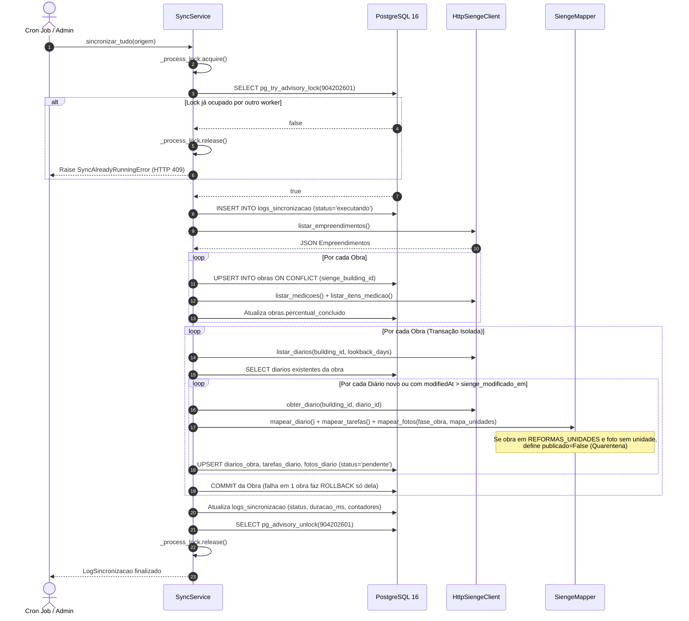

---
id: 11.04 Ingestão e Concorrência (SyncService)
aliases:
  - Ingestão e Concorrência
  - SyncService
tags:
  - tipo/projeto
  - projeto/app
  - backend
  - sincronizacao
  - concorrencia
  - advisory-lock
  - sienge
status: ativo
modulo: App & Portal
sistema: Sienge ERP & Portal do Condômino
upstream:
  - "[[11.01 App - Portal do Condômino]]"
---

# 11.04 Ingestão, Concorrência & Idempotência (SyncService)

> Detalhamento do motor de sincronização, controle de concorrência com travas distribuídas, isolamento transacional por obra e upserts idempotentes.

---

## 1. Controle de Concorrência e Dupla Exclusão Mútua

Para evitar que uma sincronização manual (`POST /api/v1/sync`) colida com o disparo automático do Cron Job (`APScheduler` executando às 06h e 18h), ou que múltiplos workers Uvicorn sincronizem a mesma obra simultaneamente, o `SyncService` implementa **dupla trava de exclusão mútua**:

1. **`asyncio.Lock()` (`_process_lock`):** Trava instantânea em memória dentro do mesmo processo Python, impedindo reentrância na mesma instância.
2. **PostgreSQL Advisory Lock (`pg_try_advisory_lock`):** Trava atômica distribuída no nível do banco de dados entre múltiplos processos/containers. Se outro worker já detiver a chave numérica `904202601`, o PostgreSQL retorna `False` imediatamente (sem enfileirar nem travar conexões) e a API responde imediatamente com **`HTTP 409 Conflict`** (`SyncAlreadyRunningError`).

---

## 2. Idempotência e Transações Isoladas por Obra

Toda gravação de entidades sincronizadas utiliza **`INSERT ... ON CONFLICT DO UPDATE` nativo do PostgreSQL** (`sqlalchemy.dialects.postgresql.insert`), garantindo **idempotência absoluta** sobre as chaves naturais do Sienge:
* Obras: `sienge_building_id`
* Diários de Obra: `(obra_id, sienge_diario_id)`
* Tarefas de Diário: `(diario_id, tipo, sienge_item_id)`
* Fotos de Diário: `(diario_id, sienge_attachment_number)`

### Isolamento Transacional de Falhas:
* A sincronização itera sobre cada obra ativa em **sessões/transações isoladas**.
* Caso o processamento de uma obra falhe (ex.: erro de rede no Sienge ou formato de anexo inválido), é realizado o `ROLLBACK` **exclusivamente dessa obra**, permitindo que as demais obras continuem sendo sincronizadas normalmente e gravando o log com status `PARCIAL`.

---

## 3. Diagrama de Sequência de Ingestão

---

## 4. Conexões e Links Relacionados
* **Nota Mestre:** [[11.01 App - Portal do Condômino]]
* **Regras do Ponto X & Quarentena:** [[11.02 Regras de Negócio e Multi-tenancy (Ponto X)]]
* **Processamento de Fotos:** [[11.05 Pipeline de Mídia e Otimização WebP]]
* **Resiliência e Lookback:** [[11.07 Resiliência, Rate Limit e Carga de Histórico]]
* **Integração com Diário de Obra do Sienge:** [[32.10 Diário de Obra Consolidado (RDO)]]
* **Integração com Medição de Obra do Sienge:** [[32.05 Boletim de Medição de Obra]]
