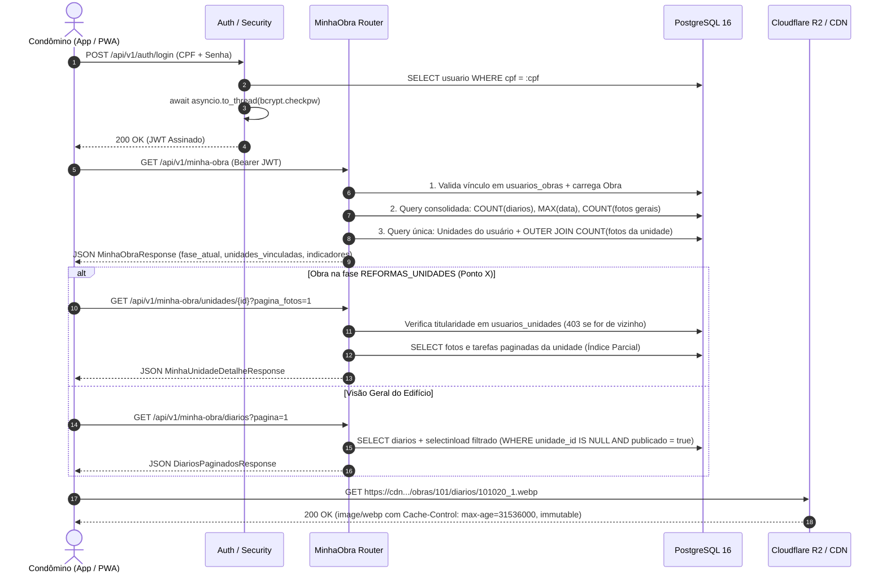

# 11.06 Fluxo de Leitura de Alta Performance (Minha Obra)

> Arquitetura de leitura rápida (< 5ms) para centenas de condôminos simultâneos, validação de titularidade, paginação e alternância de telas no Ponto X.

---

## 1. Arquitetura de Leitura "Zero Sienge Direct"

Nenhuma requisição de leitura disparada pelos condôminos ou pelo PWA toca na API do ERP Sienge:
1. **Banco de Dados Local Otimizado:** Todas as consultas rodam contra o PostgreSQL 16 local através do pool assíncrono `asyncpg`.
2. **Índices Parciais e Compostos:** O schema possui índices específicos para filtrar por `(obra_id, unidade_id, publicado, data DESC)`, garantindo que queries de feed e galeria respondam em **2 a 5 milissegundos**.
3. **Fotos Entregues por CDN:** O backend apenas retorna URLs assinadas/públicas apontando para a CDN (Cloudflare R2). O tráfego de megabytes de imagens é 100% descarregado da infraestrutura do backend.

---

## 2. Endpoints do Condômino (`/api/v1/minha-obra`)

Todas as rotas exigem autenticação via cabeçalho `Authorization: Bearer <TOKEN_JWT>`. O usuário logado é extraído via injeção de dependência `Depends(obter_usuario_atual)`.

### 2.1 Visão Geral da Obra (`GET /api/v1/minha-obra`)
* **Parâmetro opcional:** `obra_id` (se o condômino tiver mais de uma obra vinculada).
* **Validação:** Checa se o `obra_id` consta na lista de obras autorizadas do usuário em `usuarios_obras`.
* **Resposta (`MinhaObraResponse`):**
  * Metadados da obra (nome, cidade, `fase_atual`, `percentual_concluido`).
  * Indicadores consolidados: total de diários publicados, última data registrada, quantidade total de fotos da área comum.
  * Lista de unidades do próprio condômino na obra com respectivos percentuais de reforma e pareceres da engenharia.

### 2.2 Feed de Diários do Edifício (`GET /api/v1/minha-obra/diarios`)
* **Parâmetros:** `obra_id`, `pagina` (padrão 1), `limite` (padrão 10).
* **Filtro Estrito de Privacidade:** Carrega apenas diários e fotos coletivas:

  ```sql
  WHERE fotos_diario.unidade_id IS NULL AND fotos_diario.publicado = true
  ```

  Fotos de apartamentos privados jamais aparecem nesta listagem.

### 2.3 Detalhes da Unidade Privada (`GET /api/v1/minha-obra/unidades/{unidade_id}`)
* **Validação de IDOR:** Valida se a `unidade_id` solicitada está vinculada ao `usuario.id` na tabela associativa `usuarios_unidades`. Se for unidade de outro investidor, retorna imediatamente **`HTTP 403 Forbidden`**.
* **Resposta (`MinhaUnidadeDetalheResponse`):**
  * `numero_unidade`, `bloco`, `tipo_planta`.
  * `percentual_reforma`, `status_reforma`, `observacoes_reforma`.
  * Lista cronológica de tarefas e fotos exclusivas do interior do apartamento (`WHERE unidade_id = :id AND publicado = true`).

---

## 3. Diagrama de Sequência de Leitura



---

## 4. Catálogo Consolidado de Endpoints da API (`/api/v1`)

| Contexto | Método | Rota | Autenticação | Descrição |
| :--- | :---: | :--- | :--- | :--- |
| **Health** | `GET` | `/api/v1/health` | Pública | Verifica conectividade ativa com o PostgreSQL (`SELECT 1`). |
| **Auth** | `POST` | `/api/v1/auth/login` | Pública (Rate Limit IP) | Autentica por CPF e senha (`bcrypt` off-thread) e emite JWT. |
| **Auth** | `GET` | `/api/v1/auth/me` | Bearer JWT | Retorna dados cadastrais e status de aceite LGPD do usuário logado. |
| **Auth (LGPD)** | `POST` | `/api/v1/auth/aceitar-termo-privacidade` | Bearer JWT | Registra o timestamp de ciência e aceite do Termo de Privacidade no 1º login. |
| **Condômino** | `GET` | `/api/v1/minha-obra` | Bearer JWT | Retorna resumo da obra, `fase_atual`, contadores gerais, obras e unidades vinculadas. |
| **Condômino** | `GET` | `/api/v1/minha-obra/diarios` | Bearer JWT | Lista diários gerais paginados (`unidade_id IS NULL`) com filtros opcionais de data. |
| **Condômino** | `GET` | `/api/v1/minha-obra/diarios/{diario_id}` | Bearer JWT | Detalha um diário geral específico da obra do condômino. |
| **Condômino** | `GET` | `/api/v1/minha-obra/unidades` | Bearer JWT | Lista exclusivamente as unidades autônomas pertencentes ao condômino. |
| **Condômino** | `GET` | `/api/v1/minha-obra/unidades/{unidade_id}` | Bearer JWT | Retorna dossiê da unidade (status, % de reforma, parecer, tarefas e fotos paginadas). |
| **Admin** | `GET` | `/api/v1/admin/fotos-quarentena` | Bearer JWT (`ADMIN`) | Lista fotos retidas em quarentena (`publicado=False`) aguardando classificação. |
| **Admin** | `PATCH` | `/api/v1/admin/fotos/{foto_id}/classificar` | Bearer JWT (`ADMIN`) | Classifica foto como Edifício Geral (`unidade_id=null`) ou Unidade específica e publica. |
| **Admin** | `PATCH` | `/api/v1/admin/obras/{obra_id}` | Bearer JWT (`ADMIN`) | Atualiza `percentual_concluido`, `fase_atual`, `situacao` e `data_previsao_entrega`. |
| **Admin** | `PATCH` | `/api/v1/admin/obras/{obra_id}/fase` | Bearer JWT (`ADMIN`) | Altera rapidamente a fase atual da obra (ex.: ativar Ponto X). |
| **Admin** | `GET` | `/api/v1/admin/usuarios` | Bearer JWT (`ADMIN`) | Lista perfis com busca por nome/CPF, filtro por perfil e vínculos resolvidos em lote. |
| **Admin** | `GET` | `/api/v1/admin/usuarios/{usuario_id}` | Bearer JWT (`ADMIN`) | Detalha um usuário específico e seus IDs de obras e unidades vinculadas. |
| **Admin** | `POST` | `/api/v1/admin/usuarios` | Bearer JWT (`ADMIN`) | Cria novo usuário (`admin` ou `condomino`) com hash Bcrypt off-thread e bulk insert. |
| **Admin** | `PATCH` | `/api/v1/admin/usuarios/{usuario_id}` | Bearer JWT (`ADMIN`) | Atualiza cadastro, senha, status `ativo` e vínculos (com trava anti-lockout). |
| **Admin** | `DELETE` | `/api/v1/admin/usuarios/{usuario_id}` | Bearer JWT (`ADMIN`) | Remove usuário permanentemente (impede autoexclusão ou remoção do último Admin). |
| **Sync** | `POST` | `/api/v1/sync` | JWT `ADMIN` ou `X-Admin-Key` | Dispara sincronização manual imediata (todas as obras ou `obra_id` específico). |
| **Sync** | `GET` | `/api/v1/sync/logs` | JWT `ADMIN` ou `X-Admin-Key` | Lista o histórico auditável de execuções da sincronização (`logs_sincronizacao`). |

---

## 5. Conexões e Links Relacionados
* **Nota Mestre:** [[11.01 App - Portal do Condômino]]
* **Regras de Negócio do Ponto X:** [[11.02 Regras de Negócio e Multi-tenancy (Ponto X)]]
* **Autenticação & Tokens:** [[11.09 Autenticação e Gestão de Usuários]]
* **Pipeline de Mídia:** [[11.05 Pipeline de Mídia e Otimização WebP]]
* **Modelagem e Otimizações SQL:** [[11.12 Modelagem de Dados Relacional e Otimizações SQL]]
* **Consumo no Frontend:** [[11.13 Frontend, PWA e Design System Editorial]]
* **Privacidade e LGPD:** [[11.14 Conformidade com a LGPD e Segurança de Dados]]
