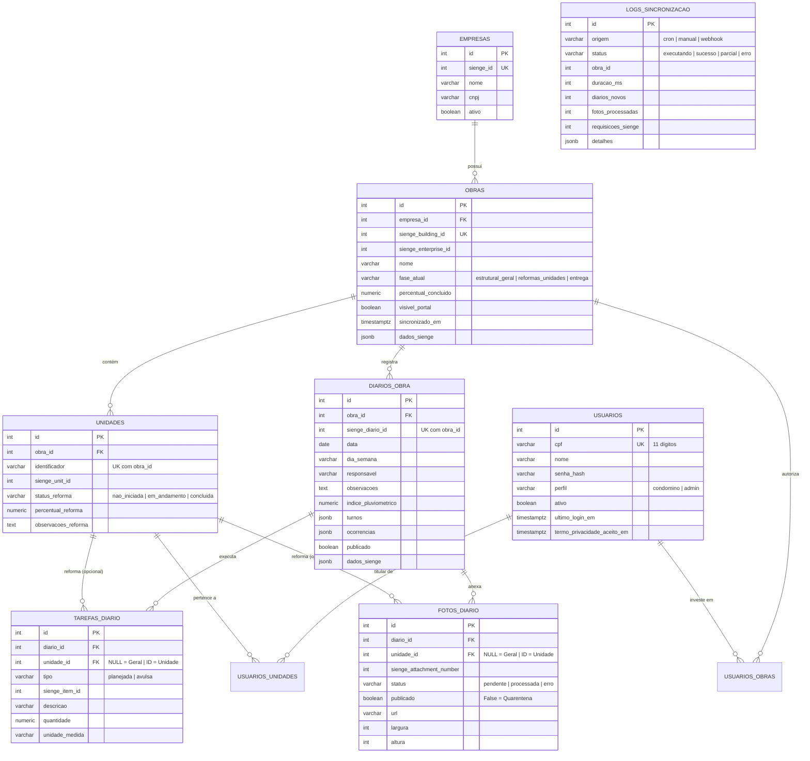

# 11.12 Modelagem de Dados Relacional & Otimizações SQL

> Diagrama Entidade-Relacionamento (ER), tipagem no PostgreSQL 16, índices parciais de alto desempenho e estratégias de eliminação de queries N+1 para escala de 750 a 2.000+ condôminos simultâneos.

---

## 1. Diagrama Entidade-Relacionamento (PostgreSQL 16)

A persistência do `portal_backend` baseia-se em um schema relacional normalizado no PostgreSQL 16, orquestrado via **SQLAlchemy 2.0 Async** com tipagem estrita `Mapped[T]` e mixins para rastreamento de auditoria e integração:



---

## 2. Índices Parciais e Otimizações de Desempenho

Para assegurar tempos de resposta sub-milissegundo mesmo com o crescimento de centenas de diários e milhares de imagens em alta resolução, o schema utiliza **índices parciais (Filtered Indexes)**:

### 2.1 `ix_fotos_diario_geral_parcial` (`app/models/foto.py`)
```sql
CREATE INDEX ix_fotos_diario_geral_parcial 
ON fotos_diario (diario_id, ordem) 
WHERE unidade_id IS NULL AND publicado = true;
```
* **Função Técnica:** Permite que o `selectinload` do feed geral do edifício carregue exclusivamente as fotos da área comum sem realizar *full table scan* em fotos privativas de reformas de apartamentos.

### 2.2 `ix_fotos_diario_unidade_parcial` (`app/models/foto.py`)
```sql
CREATE INDEX ix_fotos_diario_unidade_parcial 
ON fotos_diario (unidade_id, status, publicado) 
WHERE unidade_id IS NOT NULL;
```
* **Função Técnica:** Garante resposta instantânea ao carregar a galeria e o dossiê privativo de qualquer uma das centenas de unidades autônomas, mantendo a árvore B-Tree compacta.

### 2.3 `ix_diarios_obra_obra_id_data` (`app/models/diario.py`)
```sql
CREATE INDEX ix_diarios_obra_obra_id_data 
ON diarios_obra (obra_id, data DESC);
```
* **Função Técnica:** Acelera a paginação do feed cronológico de diários de obra (`GET /api/v1/minha-obra/diarios`) e a busca do último diário registrado.

---

## 3. Eliminação Rígida de Queries N+1

O backend implementa padrões que evitam a explosão de consultas ao banco de dados em loops:

1. **Agregação Escalar Consolidada em `minha_obra.py`:**
   * O endpoint `GET /api/v1/minha-obra` resolve contadores como `total_diarios`, `ultimo_diario_data` e `total_fotos` em **uma única query com `scalar_subquery()`**.
   * As unidades vinculadas ao condômino e a respectiva contagem de fotos de cada uma são resolvidas em **uma única query com `OUTER JOIN`**, sem queries individuais por apartamento.
2. **Resolução de Usuários em Lote em `admin.py` (`_montar_usuarios_admin_em_lote`):**
   * Ao listar dezenas de usuários no painel administrativo (`GET /api/v1/admin/usuarios`), todos os vínculos de obras (`usuarios_obras`) e unidades (`usuarios_unidades`) são resolvidos em **2 queries em lote com `IN (:ids)`**, atingindo complexidade de consultas $O(1)$ independentemente do número de registros listados na página.

---

## 4. Preservação de Dados Brutos contra API Drift (`JSONB`)

Todas as tabelas que recebem dados do Sienge (`obras`, `diarios_obra`, `tarefas_diario`, etc.) herdam o mixin `SiengeMixin`, que inclui uma coluna `dados_sienge` do tipo `JSONB`.
* O payload bruto original recebido do ERP é armazenado integralmente.
* Caso surja a necessidade de exibir novos atributos de canteiro futuramente, a migração dos dados pode ser realizada via script SQL interno sem consumir cotas da API REST do Sienge.

---

## 5. Conexões e Links Relacionados
* **Nota Mestre de Arquitetura:** [[11.01 App - Portal do Condômino]]
* **Regras do Ponto X & Quarentena:** [[11.02 Regras de Negócio e Multi-tenancy (Ponto X)]]
* **Estrutura de Modelos SQLAlchemy:** [[11.03 Estrutura de Código e Camadas do Backend]]
* **Endpoints de Leitura:** [[11.06 Fluxo de Leitura e Endpoints do Condômino]]
* **Segurança e LGPD:** [[11.14 Conformidade com a LGPD e Segurança de Dados]]
