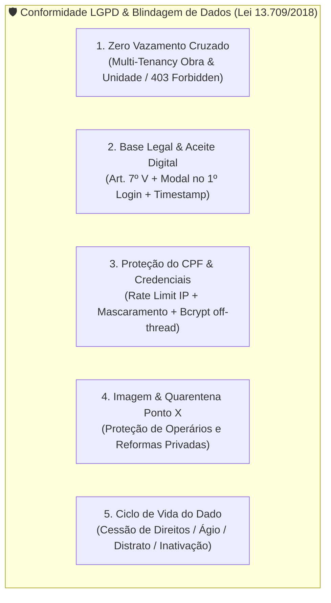

# 11.14 Conformidade com a LGPD & Segurança de Dados

> Salvaguardas técnicas, jurídicas e arquiteturais implementadas no Portal do Condômino em conformidade estrita com a Lei Geral de Proteção de Dados (Lei nº 13.709/2018).

---

## 1. Contexto Regulatório e Princípios de Privacidade

O Portal do Condômino processa informações patrimoniais e pessoais de investidores e adquirentes de imóveis de alto padrão. Para garantir **blindagem jurídica e confidencialidade**, o sistema foi projetado sob o princípio de *Privacy by Design & by Default*, fundamentando o tratamento no **Artigo 7º, Inciso V da LGPD (Execução de Contrato)** — prestação de contas do avanço físico e da entrega do imóvel contratado.

---

## 2. As 5 Salvaguardas Técnicas e Jurídicas Integradas



### 2.1 Salvaguarda 1: Prevenção Rígida contra Vazamento Cruzado
* **Zero Exposição de Lista de Vizinhos:** Nenhum endpoint do condômino retorna listas de proprietários, nomes, telefones, e-mails ou números de apartamentos vizinhos.
* **Isolamento SQL no Feed Coletivo:** O feed geral da obra (`GET /api/v1/minha-obra/diarios`) filtra estritamente no banco de dados:
  ```sql
  WHERE fotos_diario.unidade_id IS NULL AND fotos_diario.publicado = true
  ```
* **Validação Rígida de Titularidade (Anti-IDOR):** O acesso a `/api/v1/minha-obra/unidades/{unidade_id}` exige validação de vínculo na tabela `usuarios_unidades`. Se um condômino tentar acessar a unidade de outro investidor forçando o ID na URL, a API retorna **`HTTP 403 Forbidden`**.

### 2.2 Salvaguarda 2: Base Legal & Aceite do Termo no 1º Login
* O tratamento dos dados de evolução física baseia-se na obrigação contratual de prestação de contas da construtora.
* **Registro de Ciência e Aceite:** No primeiro acesso do usuário (`usuario.termo_privacidade_aceito_em == null`), o frontend bloqueia a navegação e abre o **Modal de Termos de Uso e Política de Privacidade**.
* O clique em aceitar dispara `POST /api/v1/auth/aceitar-termo-privacidade`, registrando no PostgreSQL o timestamp com fuso horário (`timestamptz`).

### 2.3 Salvaguarda 3: Proteção e Sanitização de CPF e Credenciais
* **Rate Limiting em Janela Deslizante (*Sliding Window*):** O endpoint `/api/v1/auth/login` restringe tentativas abusivas de login por IP (com suporte aos cabeçalhos `CF-Connecting-IP` da Cloudflare e `X-Forwarded-For`), bloqueando ataques de força bruta com `HTTP 429 Too Many Requests` e cabeçalho `Retry-After`.
* **Mascaramento em Logs de Auditoria (`mascarar_cpf`):** Os logs do servidor Uvicorn e os registros do banco de dados nunca exibem o CPF em texto claro, convertendo-o para o padrão sanitizado `***.456.789-**`.
* **Criptografia Forte de Senhas:** Hashes gerados via Bcrypt (12 rounds) executados fora do *event loop* assíncrono via `asyncio.to_thread`.

### 2.4 Salvaguarda 4: Direito de Imagem e Quarentena no Ponto X
* **Fase Estrutural Geral (`estrutural_geral`):** O foco dos diários é o avanço técnico (fundações, lajes, armações e fachada). A recomendação aos engenheiros é evitar fotos com enquadramento frontal em operários individuais sem autorização formal de uso de imagem. A publicação é direta (`publicado = true`).
* **Fase de Reformas das Unidades (`reformas_unidades` - Ponto X):** Fotos que chegarem do Sienge sem tag explícita de unidade entram em **Quarentena Automática (`publicado = false`)**, eliminando qualquer risco de fotos de reformas particulares vazarem no feed público do edifício.

### 2.5 Salvaguarda 5: Gestão do Ciclo de Vida do Dado (Ágio e Distrato)
* **Venda de Ágio / Cessão de Direitos:** Caso o comprador transfira a unidade antes da entrega das chaves, o administrador remove o vínculo daquela unidade via CLI ou API. O antigo investidor perde o acesso instantaneamente.
* **Distrato Contratual:** O perfil do condômino é marcado como inativo (`ativo = False`), revogando imediatamente a emissão de novos tokens JWT e preservando o histórico auditável de registros conforme prazos prescricionais do Código Civil.

---

## 3. Conexões e Links Relacionados
* **Nota Mestre de Arquitetura:** [[11.01 App - Portal do Condômino]]
* **Regras do Ponto X & Quarentena:** [[11.02 Regras de Negócio e Multi-tenancy (Ponto X)]]
* **Autenticação e Perfis (CRUD):** [[11.09 Autenticação e Gestão de Usuários]]
* **Modelagem e Índices:** [[11.12 Modelagem de Dados Relacional e Otimizações SQL]]
* **Frontend & Modal LGPD:** [[11.13 Frontend, PWA e Design System Editorial]]
