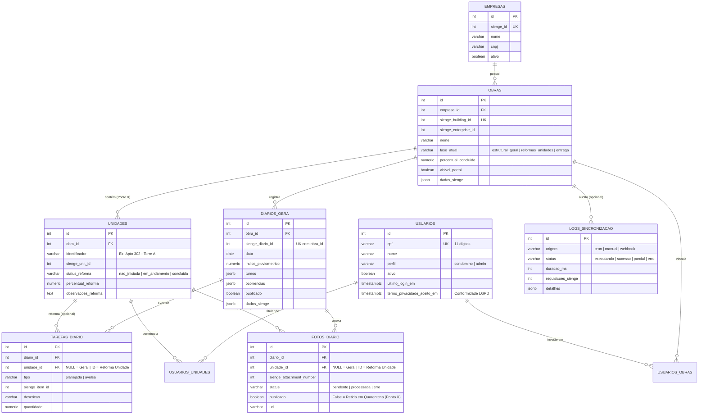

# Banco de Dados: Estrutura, Índices e Evolução (`PostgreSQL 16`)

## 1. Diagrama Entidade-Relacionamento (ERD)



---

## 2. Organização do Código (`app/models/`)

| Arquivo | Conteúdo |
| :--- | :--- |
| `base.py` | `Base`, convenção determinística de nomes de constraints e mixins (`IdMixin`, `TimestampMixin`, `SiengeMixin`) |
| `enums.py` | Enums de domínio (`PerfilUsuario`, `FaseObra`, `StatusReformaUnidade`, `TipoTarefa`, `StatusFoto`, `StatusSincronizacao`, `OrigemSincronizacao`) gravados como `VARCHAR` |
| `empresa.py` | Tabela `empresas` |
| `obra.py` | Tabela `obras` (inclui `fase_atual` para controle do Ponto X e `percentual_concluido`) |
| `unidade.py` | Tabela `unidades` e tabela associativa `usuarios_unidades` |
| `usuario.py` | Tabela `usuarios` (inclui `termo_privacidade_aceito_em`) e tabela associativa `usuarios_obras` |
| `diario.py` | Tabela `diarios_obra` (turnos e ocorrências em `JSONB`) |
| `tarefa.py` | Tabela `tarefas_diario` (vinculada ao diário e opcionalmente a uma `unidade_id`) |
| `foto.py` | Tabela `fotos_diario` (metadados WebP, `unidade_id`, `publicado` e índices parciais PostgreSQL) |
| `log_sincronizacao.py` | Tabela `logs_sincronizacao` (auditoria de consumo da cota Sienge e rastreamento de erros) |
| `__init__.py` | Registro central de todos os models para autogenerate do Alembic |

---

## 3. Índices de Alta Performance (Escala 750+ Condôminos)

1. **`ix_fotos_diario_geral_parcial`:** Índice parcial PostgreSQL (`WHERE unidade_id IS NULL AND publicado = true`) sobre `(diario_id, ordem)`. Acelera o carregamento do feed geral do edifício ignorando fotos privadas de apartamentos e fotos em quarentena.
2. **`ix_fotos_diario_unidade_parcial`:** Índice parcial PostgreSQL (`WHERE unidade_id IS NOT NULL`) sobre `(unidade_id, status, publicado)`. Garante resposta sub-milissegundo na aba *"Minha Unidade"*.
3. **`ix_diarios_obra_obra_id_data`:** Índice composto em `(obra_id, data)` para paginação cronológica instantânea.

---

## 4. Receitas de Manutenção (Alembic)

### Adicionar uma coluna
1. Adicione o campo no model correspondente em `app/models/`.
2. Gere e aplique a migração:
   ```powershell
   .\.venv\Scripts\alembic.exe revision --autogenerate -m "descricao_da_mudanca"
   .\.venv\Scripts\alembic.exe upgrade head
   ```

### Promover um dado do `dados_sienge` (`JSONB`) para coluna
Crie a coluna e, na mesma migração, popule a partir do payload bruto já salvo sem precisar reconsultar o Sienge:
```python
op.execute("UPDATE obras SET area_construida_m2 = (dados_sienge->>'builtArea')::numeric")
```

### Desfazer a última migração
```powershell
.\.venv\Scripts\alembic.exe downgrade -1
```
